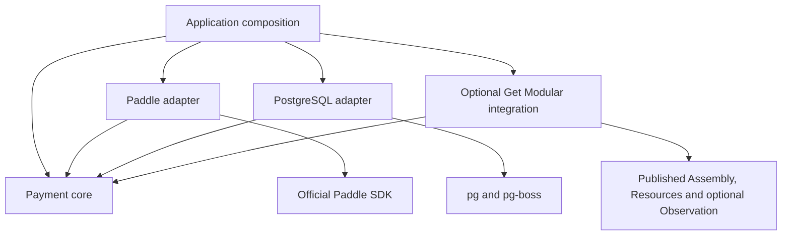

# Architecture and observable guarantees

## Ownership and dependency direction

The SDK owns technical payment operations and evidence. It does not become the application's commercial subscription model, credit ledger or usage meter. Its core-owned [contracts](../packages/payments-core/src/contracts.ts) are provider-neutral. Outward runtime calls use consumer-shaped ports; their source dependencies still point inward.

| Owner | Authoritative data and decisions |
| --- | --- |
| Payment owner | Intents, dispatch attempts, provider bindings, inbox, observations, immutable facts, evidence revisions and delivery obligations |
| Commercial access owner | Product subscriptions, entitlement policy, restrictions, validity and lifecycle decisions |
| Credit accounting owner | Included and purchased buckets, causal grants, holds, corrections, restoration, consumption and audit |
| Operational usage owner | Measured execution/usage; it cannot establish that a purchase settled |
| Host | Authentication and authorization, catalog policy, configuration, HTTP/UI, secrets, worker/pool ownership and deployment recovery fence |

These remain independent owners even on one PostgreSQL server. No shared Unit of Work, cross-owner SQL, repository reuse or distributed payment-plus-credit transaction is exposed. Financial evidence crosses the boundary through the durable public delivery protocol. An access success cannot establish a credit effect, and a payment subscription projection cannot authorize product use.

The first provider/profile supports one monthly recurring price, quantity one, no trial, plus independent one-time purchases. Trial, mixed baskets/seats, proration plan-change commands, pause/resume, manual invoices, off-session charging, provider usage billing and refund initiation are outside the public command profile. Their external observations are retained and classified as unsupported/held when necessary. `unsupported` is an observable result, never a successful no-op.

## Three local commit boundaries

| Boundary | Commits atomically | Does not establish |
| --- | --- | --- |
| T1: authenticated ingress | Source receipt, digest/verification metadata, deduplication and adverse barrier/work obligation | Fulfillment or a consumer effect |
| T2: payment reduction | Full bounded read-set validation, observations/bindings/facts, evidence revision, delivery targets and inbox completion | A transaction with an independent consumer |
| T3: consumer acceptance | Consumer receipt/revision fence, current contributions, decision, effect or persistent held obligation and owner outbox | Another consumer's success |

HTTP 200 follows confirmed T1. Producer delivery ACK follows confirmed T3. Both can be replayed after a lost response. Each record owner must retain durable logged data and a crash-safe local commit profile. A lost COMMIT reply is uncertainty, not proof of rollback.

Adverse input admitted before a successful T2 commit contributes to that revision's barrier/read-set validation. An adjustment admitted after T2 can reach a consumer after a paid-only revision and requires eventual correction. A last-moment read before send cannot close this cross-owner interval. Product owners decide whether provisional grants or spendability holds are appropriate.

## Storage and queue boundaries

`PaymentStore` belongs to core; the host supplies its implementation. PostgreSQL
is the first durable adapter, not a core dependency or a requirement to create a
separate database server. A different adapter must preserve the port's confirmed
commit, concurrency, uncertainty and replay contract. The [developer stack](developer-stack.md)
owns the approved adapter-local query toolkit; ORM objects never cross this port.

The existing PostgreSQL worker uses `pg-boss` for replaceable wake-ups. Payment
records and obligations remain authoritative after every queue job is deleted;
bounded repair recreates runnable work. Queue enqueue may share the existing
payment transaction through pg-boss's public `db` seam. Workers re-read saved
authority before execution, and a queue retry never authorizes an unknown
external mutation. [The adapter guide](../packages/payments-postgres/README.md)
owns its operational configuration and recovery procedure.

| Mechanism | Contract and owner |
| --- | --- |
| `watch` / `load` | Optional, replaceable read projections with Resources lifetime; no durable financial delivery |
| Payment evidence and deliveries | Core-owned immutable identity/digest, revisions, pending delivery and acknowledgement after consumer T3 |
| Queue or broker | Infrastructure scheduling/transport; successful enqueue or broker acknowledgement does not prove consumer T3 |

An application can drive the public processing and delivery methods without
using the PostgreSQL job runner. No generic EventBus, shared ORM transaction or
mandatory external broker is exposed by core. A future broker integration must
relay durable obligations, tolerate duplicate/out-of-order delivery, preserve
the consumer receipt boundary and recover from crashes between send and receipt.
It must not dual-write PostgreSQL and a remote broker as if they shared one
transaction. That broker adapter and cross-process receipt path are not currently
implemented or qualified; a TypeScript port alone would not prove them.

## Mutation uncertainty and local concurrency

An intent records the immutable offer snapshot and a stable `(scope, buyerId, requestKey)` identity before external work. A separate CAS commit records `dispatch_started`, attempt ID, immutable command fingerprint and mutation-lane fencing before the SDK call. A failed or unconfirmed marker commit never authorizes dispatch. Provider I/O occurs outside SQL transactions.

After that marker, a crash, timeout, network/JSON/mapping error or lost provider response can leave the operation `outcome_unknown`. There is **no automatic second external mutation**. This includes Paddle's payment-method-change operation, whose HTTP GET can create a transaction. Queue retries, a new request key, a local lease expiry and an empty provider search cannot prove nonexecution.

One unfinished mutation lane serializes a local mutable provider entity. Read observations can continue. `resolveUnknownOperation` is an administrative host-authorized action with expected revisions, actor, audit reference and reason. It can retain uncertainty, bind a proved outcome, or explicitly admit a new attempt with accepted duplicate risk. Late results remain immutable attempt evidence and cannot overwrite a newer lane using a stale token.

A core operation deadline limits caller waiting. The official SDK does not provide a public per-request AbortSignal/timeout, so an open SDK promise may remain physically active after the local result is unknown. Lifecycle debt remains visible until actual settlement. [Shutdown and recovery](operations.md) explain what the host must retain.

## Evidence, revisions and causal identities

`factId`, `messageId`, provider event IDs, notification IDs, aggregate revisions and consumer effect keys have different meanings. Webhook deduplication keys include provider/account/environment and event ID; notification ID is not the payment identity. Immutable evidence message identity derives from producer namespace, payment scope, aggregate and evidence revision, with a separately verified body digest. A body cannot change under an existing identity.

Provider versions retain exact timestamp fractions. Newer unknown mutable fields remain unknown; `lastKnown` does not silently become current. Equal provider version with conflicting content becomes a visible conflict. A complete evidence message is a versioned full snapshot, so consumers cannot treat every repeated adjustment as a fresh negative delta. A held control revision advances the consumer's knowledge and prevents an older complete snapshot from reopening eligibility.

Consumers fence each source aggregate's revision before effects: lower is stale, equal/same digest is duplicate, equal/different digest is conflict. Multi-source decisions additionally lock or CAS their own benefit/access basis and validate the whole current evidence read set. Revisions from different source aggregates are never compared numerically as if they shared a clock.

Grant identities belong to the credit owner: one-time intent plus local benefit slot; recurring local subscription basis plus benefit slot and exact paid period. The initial recurring purchase also needs an originating-intent guard in the same T3. Policy version is immutable metadata, not a way to create another grant identity. Distinct paid provider transactions remain distinct financial facts even when they compete to support one benefit.

Two external initial subscriptions for one intent are retained as duplicate-payment evidence. An audited technical stream selection can choose the renewal support stream using a complete expected read set; it does not decide product entitlement. Consumers retain their initial-intent guard and causal policy. A held-and-ACKed consumer decision needs an owner-local durable redrive and can be resolved without a synthetic payment revision.

## Trust boundaries and custody

Scope comes from trusted endpoint/connection configuration. Buyer identity comes from host authentication. Local saved ownership and server-selected offers establish authority; email, client IDs, price equality and Paddle `custom_data` alone do not. A normal first checkout may have a null customer and later acquire the observed payer without changing the locally bound beneficiary. That transition does not grant customer-wide portal authority.

Management portal sessions require explicit authorization over the entire provider customer. Subscription links only affect navigation. URLs are ephemeral sensitive data and should not be logged or retained as durable evidence. A capability facet limits exposed methods but is not a tenant/security sandbox.

Verified webhooks retain original bytes and authentication context. Authenticated API evidence is the official SDK's mapped representation. API1/SDK3.10.0/decoder2 permits documented required nullable fields to have `schema_assumed_null` provenance; optional/dropped fields remain unknown. This is a declared trust assumption, not original-wire custody. The [Paddle guide](../packages/payments-paddle/README.md) owns the detailed decoder and pagination contract.

## Get Modular and extension boundaries

The integration uses real published static modules, Assembly preparation/run inputs and Resources ownership. It creates the same plain core runtime and borrows provider/store/pool dependencies. Frozen checkout/read/management/processing/delivery facets segregate consumers' needs without inventing another payment service or authorization layer.

The coordinated Observation release train was published on 2026-10-20. The
[public registry record](../qualification/observation/published-artifacts.json)
binds exact versions, integrity and archive identity; the published bytes match
the previously reviewed original candidates. The optional
`@agent-teams/payments-get-modular/observation` entrypoint delivers one shared
purchase projection and Assembly composition. Static consumers can omit the
Observation peer. The [integration guide](../packages/payments-get-modular/README.md)
owns setup and `watch`/`load` semantics; `pnpm test:observation` checks the actual
packed public entrypoint, coherent peers and real financial/lifecycle scenarios.

Hooks observe replaceable read projections of durably stored state. They cannot create checkout, publish financial evidence, grant/consume credits or replace T3/ACK. New providers implement the existing semantic ports and declare capabilities; new storage adapters must preserve the durable commit, read-set, uncertainty and replay guarantees. Foundation's [source-dependency policy](../architecture/foundation/source-dependencies.yaml) checks source import direction; scenario suites check the observable contract.
