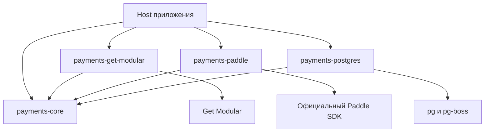

# Платёжная библиотека: исследование и план реализации

Итоговый план от 19 октября 2026 после четырёх волн независимого ревью. Решение: небольшая встраиваемая TypeScript-библиотека с нейтральным ядром, первым адаптером Paddle Billing, отдельным PostgreSQL adapter и optional Get Modular integration. Поддерживаются разовые покупки и месячные подписки; продуктовые права, кредитный учёт и AI usage сохраняют отдельных владельцев. Имена пакетов/API ниже — проектные обозначения. Реализация и её runtime/sandbox qualification — последующие этапы этого плана.

## 1. Рекомендация и границы

Создать встраиваемую TypeScript-библиотеку подтверждения покупок и синхронизации платёжного состояния. Первый адаптер — Paddle Billing. Ядро не импортирует Paddle, Get Modular, HTTP-фреймворк, UI, ORM или драйвер БД. Библиотека предоставляет надёжные факты для других компонентов; решения о доступе, начисление AI-кредитов и измерение использования имеют отдельных владельцев.

Четыре минимально оправданные точки поставки: `payments-core`, `payments-paddle`, `payments-postgres`, `payments-get-modular`. Название и npm scope выбрать перед созданием репозитория. Это четыре разные границы зависимостей, а не требование к четырём слоям каждого сценария. Тестовые утилиты — subpath, примеры — приложения в монорепозитории. Отдельного UI-пакета, собственного HTTP-сервера, общей DI-платформы и второго провайдера в v1 нет.

В v1 входят: создание серверного заказа и checkout для одного предложения; разовая покупка; первоначальная месячная подписка и её успешные продления; проверенный webhook ingress; durable inbox; подтверждённые результаты покупки; актуальная проекция подписки; отмена с явной семантикой; получение возможностей управления через провайдера с проверенной областью авторизации; обработка failure, refunds/adjustments и восстановления; durable outbox для передачи фактов; сверка с Paddle; SQL-адаптер с реальными гарантиями конкурентности; два изолированных потребителя.

Первый поддержанный коммерческий профиль: один recurring price, quantity=1, без trial и смешанной корзины; пополнения покупаются отдельной one-time транзакцией. Ядро не определяет цены, размеры квоты, скидки, срок действия кредитов или правило расходования. Эти параметры задаются версионированным каталогом приложения. Возможность Paddle не означает автоматически поддержанный сценарий библиотеки.

До следующих этапов отложены: публичное API смены плана с proration, пауза/resume и trials, mixed baskets/seats, ручные invoices, off-session дополнительные списания, usage-based billing Paddle, собственный ledger кредитов, AI metering, самостоятельный distributed billing service и реальная миграция активных подписок между провайдерами. Их внешние события нельзя игнорировать: незнакомые изменения сохраняются, классифицируются и при необходимости переводятся в разбор; неподдержанная операция возвращает явный результат.

## 2. Q и направление зависимостей

Q найден в `777genius/agent-rules`, полностью прочитан; файл версии 1.1.2 байт-в-байт совпадает с текущим. Базовое правило: граница защищает реальный инвариант или изменяемую инфраструктуру, а не увеличивает число интерфейсов. Контракты принадлежат потребителю. Runtime-вызов наружу через порт не меняет направление исходных imports.

| Компонент | Владеет | Не владеет |
| --- | --- | --- |
| Payment core | состоянием заказов/операций, дедупликацией, подтверждёнными фактами, правилами приёма факта и передачей | налогами, карточными данными, квотой продукта, AI usage |
| Paddle adapter | официальным SDK, переводом запросов/событий/ошибок, проверкой подписи, mapping возможностей | авторизацией приложения и решениями о количестве кредитов |
| Storage adapter | SQL, транзакциями, уникальностью, leases/CAS, сохранением inbox/outbox | коммерческими решениями |
| Get Modular integration | объявлением модулей и зависимостей, wiring, read projections, явным lifecycle владельца | денежной надёжностью через watch/load |
| Приложение / Platform adapter | аутентификацией, проверкой прав, каталогом, продуктовой политикой, HTTP/UI, запуском worker | копией платёжного runtime |
| Commercial Access | коммерческими правами и их проекциями в рамках уже принятой Platform | первичным payment/credit ledger |
| Будущий владелец credit ledger | отдельными quota/top-up buckets, grants, reversals, списанием и аудитом | приёмом webhook и исполнением AI |
| Operational usage | измерением фактического потребления и технической эксплуатацией | подтверждением покупки |

Platform ADR-0007 и context map уже приняли Commercial Access как владельца коммерческих соглашений, продуктовых Subscription, Entitlements и точных ограничений. Это стратегическая граница: materialized package сейчас есть только у Project Management. Commercial Accounting явно UNRESERVED; существующего принятого accounting-контекста или credit ledger план не выдумывает. Техническая provider-subscription projection библиотеки не становится вторым источником истины о продуктовой Subscription. Назначение владельца кредитного учёта и его связь с Platform требуют отдельного решения владельца продукта до production, без автоматического изменения принятых ADR.

Принятые ограничения Platform сохраняются: commercial expiry запрещает новое затронутое действие/расширение возможностей, но не удаляет Project и не закрывает чтение, экспорт или отмену. Уже запущенная работа ограничивается её execution lease/deadline. Commercial Access задаёт `validUntil` своей версии evidence и fail-closed правило после истечения; payment event timestamp или GM store revision не заменяют это решение. Коммерческое разрешение не снимает security/tenant/manual restrictions. В Orchestrator/AR не протекают plan/price/invoice DTO.

Направление imports в предлагаемой поставке:



Стрелка означает зависимость исходников. Provider/storage порты определены в core; Host выбирает конкретные реализации. Интеграция Get Modular не заставляет каждое приложение устанавливать Paddle или PostgreSQL и не является местом продуктовой авторизации.

| Принцип Q | Проверяемое применение |
| --- | --- |
| SRP | Payment evidence, коммерческие права, credit effects и usage имеют разных владельцев и причины изменения |
| OCP | Новый provider реализует существующие consumer-shaped capabilities; core не содержит ветвлений по Paddle DTO |
| LSP | Сохраняются наблюдаемые результаты, uncertainty и authorization scope; неподдержанное явно объявлено, success не имитируется |
| ISP | Checkout/read, cancellation и customer-wide management разделены по реальным потребностям, без универсального BillingService |
| DIP | Порты принадлежат core/потребителю; SDK, SQL и GM зависят внутрь, Host собирает implementations |
| DRY | Одно место владения каждым правилом/identity; SDK, queue и Foundation переиспользуются; сходные DTO разных владельцев не объединяются автоматически |

Граница и интерфейс добавляются, когда защищают один из этих контрактов. Простое количество файлов, папок, классов или одинаковый синтаксис двух структур не являются основанием для абстракции.

## 3. Публичные возможности и честная независимость от провайдера

Предлагать небольшие согласованные capability-контракты, а не копию всего Paddle SDK. Обязательный профиль провайдера: начать checkout, прочитать платёжный результат и подписку, нормализовать доказательства. Управление подпиской и портал — отдельные возможности с объявленной семантикой. Клиент проверяет профиль при композиции; runtime возвращает `unsupported`, если запрошенная опция не поддержана. Нельзя имитировать успех no-op.

Проектный API:

```ts
type PaymentScope = Readonly<{
  applicationId: string;
  provider: string;
  paymentAccountId: string;
  environment: 'sandbox' | 'production';
}>;

type Money = Readonly<{ currency: string; minorUnits: string }>;

type OperationResult<T> =
  | { kind: 'succeeded'; value: T }
  | { kind: 'pending'; operationId: string }
  | { kind: 'outcome_unknown'; operationId: string }
  | { kind: 'rejected'; code: string }
  | { kind: 'unsupported'; capability: string };

type StartPurchase = Readonly<{
  buyerId: string;
  offerId: string;
  requestKey: string;
}>;
```

`scope` берётся из доверенной серверной конфигурации экземпляра, а не из тела клиентского запроса. `paymentAccountId` — стабильный namespace merchant account, сохраняющийся при ротации ключей или замене connection instance. Одно и то же provider account/environment нельзя зарегистрировать дважды как разные idempotency domains. Credentials и connection configuration находятся отдельно. `buyerId` — локальный непрозрачный идентификатор в namespace приложения, не email и не Paddle customer ID. Приложение аутентифицирует пользователя и разрешает действие; ядро повторно проверяет локальную привязку заказа/подписки, catalog scope и соответствие операции. Публичное HTTP API не принимает внешние price/customer/subscription ID как доказательство права.

Создание заказа фиксирует `offerVersion` и неизменяемое описание того, что покупается, включая локальный `benefitSlotId`. Это идентичность обещанной возможности каталога, стабильная между внешними транзакциями за один и тот же benefit; она отличается от price ID и transaction line ID. Amount и объём выдачи клиент не задаёт. Price mapping к Paddle хранится во внешнем catalog/provider adapter. Сумму с налогом/discount рассчитывает Paddle; библиотека сверяет состав, currency и разрешённые правила предложения, а не пытается воспроизвести налоговую формулу. Предложение нельзя задним числом изменить для уже созданного заказа. Binding подписки хранит проверенный mapping её строк к локальным benefit slots и историю effective offer/policy по периодам; несовпадающий внешний plan change требует явного remapping/review, не последнего текущего каталога.

Ошибки провайдера переводятся в локальный набор: validation, unauthorized_configuration, permission_denied, conflict, rate_limited, unavailable, outcome_unknown, unsupported, ownership_mismatch, catalog_mismatch и unclassified_external_state. Сохраняются диагностические request ID и исходный provider error code во внутреннем защищённом журнале; vendor DTO и секреты наружу не выдаются. HTTP-код сам по себе не определяет безопасность повтора.

Get/read операции с доказанной семантикой допускают ограниченный retry/backoff. Для create/update/cancel/refund неизвестный исход требует сверки. Даже GET `update-payment-method-transaction` у Paddle может создавать новую нулевую транзакцию, поэтому классифицировать нужно операцию, не только HTTP-метод.

LSP здесь означает сохранение наблюдаемых гарантий, включая ошибки, области авторизации и неопределённые исходы. Fake adapter и тесты контрактов покажут независимость ядра и обработку `unsupported`; полной взаимозаменяемости с другим реальным провайдером до его интеграции не обещаем. Переключение адаптера не переносит существующие подписки или платёжные методы.

### Значение успешного результата каждой операции

| Операция | Что подтверждает успешный результат | Что делает повтор после неопределённого исхода |
| --- | --- | --- |
| `startPurchase` | `checkout_ready`: transaction ID привязан к заказу и instructions можно показать; это не оплата | Возвращает прежнюю operation; запускает сверку, не второй create |
| `readPurchase` | Известные платёжные факты/состояния с provenance, version и outstanding issues | Повторяет read; не делает новую коммерческую операцию |
| `readObservedSubscription` | Техническая provider projection, не разрешение использовать продукт | Read/reconcile; не выдаёт quota |
| `requestCancellation` | `scheduled` с effectiveAt либо `applied` с observed state | Сверяет текущее scheduled/terminal state; не меняет period_end на now |
| `openPaymentUpdate` | Checkout с purpose payment_method/recovery, не новый top-up | Учитывает, что SDK GET может создать transaction; общего GET retry нет |
| `createManagementLink` | Временная sensitive URL с customer-wide scope после отдельной авторизации | Новый session допустим только в этом nonmonetary контракте; не кэшируется |
| `ingestVerifiedInput` | Durable custody входного доказательства | Source dedup, а не повтор grant |
| `readOperation` | Различает prepared, dispatch_started, observed result, unknown и manual review | Не скрывает unknown под обычным retryable error |

Initiating refunds/plan changes/pauses — не публичные команды v1. Их observations входят в v1. Expected faults возвращаются типизированными категориями; programming/invariant errors не маскируются под business success. В реализации `rejected.code` должен быть закрытым набором общих категорий, vendor code — отдельная диагностика. `execution certainty`, operation-specific outcome и recovery guidance не объединяются в один `retryable: boolean`.

Сопоставление с другим провайдером проверено по первичной Stripe API v1 документации: Stripe допускает idempotency keys для POST с ограниченным временем хранения, Paddle не даёт произвольных ключей; Stripe checkout session имеет expire API, Paddle отменяет только eligible transactions; defaults отмены различаются. Общий контракт поэтому задаёт явное timing/purpose/uncertainty, а специфические гарантии объявляет capability profile. Это исследование различий, не реализация Stripe.

## 4. Заказ, checkout и неопределённый исход

1. Авторизованный сервер приложения выбирает offer, product approval и request key. Продуктовая политика ограничения числа активных/ожидающих подписок остаётся у продукта; sample consumers демонстрируют защиту от параллельного открытия двух месячных подписок, если такое ограничение выбрано.
2. В локальной транзакции ядро сохраняет intent, snapshot предложения и command operation. Уникальность `(scope, buyerId, requestKey)`; повтор с другим fingerprint возвращает conflict, с тем же — прежний результат/статус. Нельзя полагаться на случайно меняющийся ключ из браузера для защиты повторного нажатия.
3. Команда получает lease/attempt fencing token. Внешний запрос идёт после commit и вне открытой SQL-транзакции.
4. Перед сетевым вызовом отдельный CAS commit переводит command в `dispatch_started` и сохраняет attemptId+fingerprint. Если commit не удался, SDK не вызывается. После этой точки автоматического возврата в prepared нет: crash до фактического send тоже оставляет консервативный unknown. Paddle adapter создаёт API transaction с разрешённым price/quantity и диагностической корреляцией intent. Checkout instructions показываются только после durable external-ID binding. Браузерный `checkout.completed` и success URL служат только UI-сигналами. Draft/ready transaction при checkout может менять items/customer; использование transactionId не заменяет финальную серверную проверку состава и связи. Не переводим automatic checkout в manual invoicing ради блокировки UI-полей.
5. Ответ Paddle связывается с intent в локальной транзакции. Потеря ответа или падение после send переводят команду в `outcome_unknown`; автоматического второго create нет. Lease/fencing защищает только локальный commit и не останавливает запрос у провайдера. Просроченная in-flight monetary operation не переотправляется новым worker; её переводят в сверку. Поздний результат старой попытки можно принять как отдельное доказательство исхода после проверки актуального состояния, но не как право перезаписать его старым token. `Promise.race`/deadline ограничивает ожидание, а не физическое исполнение; SDK не предоставляет публичный AbortSignal.
6. Полученный webhook до регистрации ID сохраняется как unresolved и обрабатывается повторно после восстановления привязки. `custom_data` — подсказка корреляции, а не самостоятельная авторизация. Автоматическое связывание требует доказанной серверной корреляции, совпадения account/env, intent, customer/subject binding, полного набора offer lines и отсутствия конфликта. Если источники не позволяют доказать это — ручной разбор; совпадение email/price/суммы недостаточно.
7. Сверка ищет существующий объект ограниченно по документированным фильтрам и проверяет каждую кандидатуру. Пустой результат текущего list не доказывает, что запрос не выполнился: существуют задержки и гонки. Новая попытка возможна только после установленного безопасного исхода либо явного операционного решения с сохранённым риском дубля.

Первый checkout в v1 начинается с серверного transaction, у которого допустим `customer_id=null`. Checkout создаёт или повторно использует customer. При уже сохранённой привязке transaction→intent→локальный buyer первоначальный переход `null→observed customer` разрешён: это наблюдаемый плательщик и billing relationship, а не переопределение получателя покупки. Customer-wide authority и права по совпавшему email не появляются. Следующий отдельный intent может иметь другого плательщика; изменение уже ненулевого customer на том же привязанном transaction/subscription — durable review, пока явно авторизованная политика не разрешит перенос. Не создаём дополнительный customer API workflow только для устранения нормального первого null.

Одна локальная mutable provider entity допускает одну незавершённую mutation lane. Новый request key не обходит `dispatch_started/unknown` предыдущей операции: совместимый повтор возвращает её статус, конфликтующая команда ждёт разрешения или получает conflict. Это локальная сериализация, не блокировка внешних действий в Paddle portal. Read-only observations продолжают поступать.

Операционный разбор — узкий application use case `resolveUnknownOperation`, не прямое редактирование SQL. Host авторизует оператора. В одной payment-owner транзакции CAS проверяет expected operation revision, сохраняет actor/audit reference, основание и принятый риск, затем оставляет unknown, связывает доказанный outcome либо разрешает новую связанную attempt. Разрешение новой попытки без доказательства неисполнения явно отмечается как принятие риска дубля, не как доказанный safe retry. Поздний результат старой attempt остаётся отдельным доказательством и может создать конфликт/двойную оплату; старый token не перезаписывает новую историю. Административный UI в v1 не требуется.

Два оплаченных transaction для одного intent — два внешних денежных факта и платёжная аномалия. Их нельзя молча удалить дедупликацией. Fulfillment одного заказа остаётся однократным; лишняя оплата требует отдельного resolution/refund workflow. Новый легитимный top-up использует новый intent.

Для initial recurring intent до dispatch резервируется одна стабильная локальная техническая subscription basis. Все связанные attempts и обнаруженные provider subscription IDs — кандидаты поддержки этой basis, не новые самостоятельно оплаченные продуктовые Subscription. Две внешние подписки или разные initial periods по одному intent создают duplicate-initial-purchase hold с сохранением обеих оплат и кандидатов. Consumer атомарно проверяет initial-fulfillment guard `(application, beneficiary, originatingIntent, benefitSlotId)` вместе со своим period decision. Только явно выбранный provider stream может поддерживать дальнейшие renewal grants; unselected stream остаётся held. Commercial Access сохраняет владение продуктовой Subscription; core резервирует техническую связь и не принимает коммерческое решение. Отдельный намеренный второй intent по продуктовой политике может создать отдельную подписку.

## 5. Webhook, атомарность и доставка

Необходимые таблицы/записи группируются по ответственностям, а не по числу интерфейсов: purchase intents/operations; external bindings; inbox; transaction/subscription/adjustment records; immutable payment facts и outbox; reconciliation checkpoints. SQL-схема содержит версию, ограничения и миграции; memory store предназначен только для тестов.

### T1: принятие webhook

HTTP adapter читает неизменённые bytes тела и signature header. Paddle adapter проверяет подпись официальным SDK, account/environment назначаются по доверенной конфигурации endpoint. После проверки исходный payload и parsed envelope сохраняются в durable inbox с payload hash и verify metadata. Только после успешного commit возвращается HTTP 200, укладываясь в пять секунд. Проверка и durable append — минимальная операция приёма; бизнес-обработка выполняется после acknowledgement.

Ключ входного события — `(provider, paymentAccountId, environment, eventId)`, не notificationId. Одно событие может иметь несколько notification. При нескольких независимых БД область дедупликации локальная; безопасность маршрутизации обеспечивают проверенные bindings, а не ожидание глобального dedup между приложениями. Hash сырых bytes сохраняется для каждой webhook delivery; между raw webhook deliveries сравнивается canonical stable envelope `{event_id,event_type,occurred_at,data}` без notificationId. Одинаковый eventId с разным raw stable содержимым — anomaly; исходная запись не заменяется. Ошибка durable admission — 5xx. Валидные неизвестные типы сохраняются для диагностики/повторной обработки и не создают purchase fact. Невалидная подпись не попадает в доверенный inbox. Повтор admission уже существующего, но необработанного input также восстанавливает его work obligation.

API reconciliation — другой вид acquisition. Public SDK возвращает mapped objects, а не raw HTTP envelope: Paddle adapter сохраняет доступное представление для диагностики и передаёт core нейтральное observation с SDK/decoder/API profile, query/cursor и источником авторизации, не выдуманные исходные bytes или vendor class instances. Общая версионированная схема содержит presence/unknown для значимых полей. Raw↔mapped сравнение касается только совместно известных семантических полей; оно не доказывает равенство wire payload. Missing/undefined и dropped fields — unknown. Каждая source representation имеет свой receipt/digest; event identity объединяет observations и не подавляет более полное доказательство. Конфликт известных полей требует hold/reconcile. Decoder upgrade не создаёт новую оплату.

Конкретный SDK-only trust contract v1: Paddle API version1 + SDK3.10.0 + versioned decoder. Для документированных required nullable полей известных поддержанных структур — price `billing_cycle`/`trial_period`, transaction item/line `proration`, subscription `scheduled_change` — доверяем соответствию authenticated ответа официальной API1 schema и изученному SDK mapping. Mapped null даёт семантическое отсутствие с provenance `schema_assumed_null`, не доказательство original wire null. Non-null значения и их обязательные дети проверяются runtime. Это явное ограничение обнаружения malformed upstream response, уже скрытого collapsing mapper; оно позволяет нормальной пропущенной оплате восстановиться через API. Допущение не применяется к optional/dropped fields, GenericEvent, неизвестным структурам/версиям и не побеждает противоречащий raw receipt. Все остальные недостаточные доказательства остаются hold. Полной raw API custody и последующего восстановления потерянных полей не обещаем.

[Paddle versioning](https://developer.paddle.com/api-reference/about/versioning/): adapter задаёт `Paddle-Version: 1` через public SDK `customHeaders`; Host квалифицирует отдельную version1 notification destination. Account default и номер npm package не заменяют эти настройки. Unsupported configured API profile отвергается. P4/P5 обязаны показать положительное API-only восстановление нормальных initial/renewal/top-up и явно разрешённой zero-value commercial purchase; результат «всё безопасно удержано» для этих fixtures считается провалом gate.

Объединение partial evidence ограничено одной event identity или той же provider object version. Если более новая версия не позволяет установить mutable поле, current projection помечает его unknown/incomplete; старое значение можно хранить отдельно как lastKnown с прежней версией. Нельзя переносить старый scheduled change в новую версию как текущий, либо доказывать отсутствие старым snapshot. Immutable payment history при этом сохраняется.

Начальная подпись проверяется сразу, до очереди: SDK использует окно давности пять секунд. После durable admission worker доверяет сохранённому verification context и исходному payload, а не пытается верифицировать устаревшую delivery signature через часы. Официальный `isSignatureValid` позволяет отделить аутентификацию от DTO mapper; неизвестный тип `unmarshal` возвращает GenericEvent и изменяет casing данных. Минимальный envelope guard и сохранение raw доказательства обязательны даже при использовании SDK.

### T2: применение входного факта

Worker атомарно claim-ит событие с lease/attempt token. Он нормализует событие и при необходимости читает Paddle вне транзакции. Затем одна локальная транзакция проверяет token и binding, применяет условное обновление проекции, добавляет финансовый факт с business key, записывает outbox и отмечает inbox processed. Если любой шаг не удался — всё откатывается. После crash до commit повтор возможен; после commit retry видит сохранённый факт и не начисляет ещё раз.

Для одной покупки разные события (`transaction.paid`, `transaction.completed`, `transaction.updated`, повторная API-сверка) не создают несколько оснований на выдачу. Canonical payment confirmation для поддержанного профиля — серверная `completed` transaction, полученная через проверенный webhook или API. `paid` хранится как промежуточное состояние, но сам по себе не запускает выдачу по этому выбранному контракту. Это сознательно более поздняя точка, не отрицание того, что Paddle считает `paid` захватом оплаты.

Внутренний payment fact хранит scope, локальный buyer/intent или subscription binding, provider transaction ref, item ref, offer/catalog version, точные amounts/currency/quantity, origin/classification и billing period для каждой относящейся к нему строки. Ссылка на источник — event/API observation; receipt identity не зависит от notification ID или способа доставки.

### Конкретный storage protocol

Один внутренний `PaymentStore` предоставляет согласованные операции: `admitIntent`, `admitVerifiedInputs`, `loadReductionInput`, `commitReduction`, `beginExternalDispatch`, `recordAttemptObservation`, `finishAttempt`, `acknowledgeDelivery` и query/reconciliation cursor operations. Это consumer-shaped порт, не generic SQL API и не интерфейс на каждую таблицу. `pg.PoolClient`/ORM transaction наружу не выходят. Reducer в core получает данные и ожидаемые local revisions; adapter атомарно применяет результат либо возвращает conflict/stale_attempt.

Для inbox/adjustments/reconciliation все writers одного provider transaction блокируют одну aggregate row, создаваемую как placeholder при необходимости. В T1 валидный adjustment отмечает pending adverse evidence и увеличивает revision этой строки одновременно с inbox admission. T2 блокирует receipt, aggregate rows и bindings в едином порядке; проверяет expected revisions; сохраняет observations и unique facts; обновляет projection; создаёт evidence revision/outbox/delivery targets; отмечает processed и снимает только свой pending marker. Подготовленный до поступления refund reducer проигрывает CAS и перечитывает evidence. `READ COMMITTED` допустим только с этим протоколом блокировок/условных updates; insert-conflict требует locked read+сравнения содержимого, не равен автоматически duplicate.

Pending/review/conflict не могут остаться только локальным логом. Если affected aggregate установлен из минимального доверенного envelope, T1 также сохраняет durable obligation опубликовать changed evidence. Независимый от успешного business decoder короткий quarantine/failure commit формирует snapshot из последней доверенной истории и новых pending/conflict flags, создаёт immutable revision+delivery targets и отмечает publication obligation выполненной атомарно. При этом refund факт не выдумывается и pending marker не снимается. Восстановитель охватывает эту obligation даже после terminal/expired исходного job. Дальнейшее разрешение публикует следующую revision. Если aggregate ещё нельзя установить, сохраняется unresolved-routing/coverage issue; привязка не угадывается и адресная доставка пока не обещается. После доказанного binding создаётся соответствующая publication obligation.

Ключ completed fact: `(provider, stableAccount, environment, transactionId, completion)`. `providerLineRef` — `details.line_items[].id`, не price ID или позиция массива; он нужен для финансовой истории и allocations, но не определяет новый benefit. Локальный `benefitSlotId` берётся из immutable offer/subscription binding. Изменение mutable snapshot не отменяет извлечение ранее неизвестного immutable completion fact. Adjustment сохраняется по identity и версии, не как безымянный negative amount.

Межкомпонентный payload — immutable `PaymentEvidenceChanged`: стабильный producer namespace, scoped aggregate identity/type, local evidence revision, schema version, completed fact если известен, provider lines и local benefit/period/offer binding, все известные adjustment identities/states, pending/conflict/unsupported flags. Вариант `complete` — полный snapshot известных доказательств данного transaction, без AI balance и решения об entitlement. Revision 4 может быть применена без ожидания 3, но только по монотонному consumer protocol ниже; versioned deltas без gap protocol не вводим. Размер имеет явный предел; усечение истории запрещено. Immutable versioned reference допустим позднее, только с доступом к точной сохранённой revision, не к текущему mutable состоянию.

V1 envelope имеет два варианта: `complete` и ограниченный по размеру `held/incomplete`. Control variant содержит только bounded producer/aggregate identity, новую local revision, immutable message ID/digest и reason code/reference; он не требует передачи растущей истории. При overflow короткий commit атомарно сохраняет эту revision, targets и resolution obligation; исходные финансовые данные остаются в payment store. Тот же путь доступен quarantine/failure и subscription feed. Для control заранее резервируется предел, независимый от числа adjustments. Это явное сообщение о неполноте текущего evidence, не пустой полный snapshot: consumer сохраняет прежние contributions только как lastKnown, продвигает source revision и пересчитывает свой hold/restriction. Оmission не означает отсутствие возвратов; старый complete после нового control не восстанавливает разрешение. После разрешения или квалифицированного protocol upgrade может прийти полный snapshot более высокой revision.

Envelope/control version1 квалифицируется отдельно от расширяемой payload schema. Если доверенный, проверенный version1 envelope содержит неподдержанный payload schema, consumer принимает custody с incomplete/held состоянием и durable upgrade/review obligation, без интерпретации неизвестных полей как отсутствующих. Непонятный envelope или непроверяемая identity не получает business acknowledgement: transport сохраняет quarantine и видимую delivery obligation. Rolling upgrade не должен требовать от старого consumer декодировать новый полный payload, чтобы узнать об утрате полноты; producer сохраняет совместимый control путь. Генератор chunking, download service и mutable references для v1 не нужны.

Subscription-only изменения передаются отдельным `ObservedSubscriptionEvidenceChanged`: stable local subscription binding, local revision, provider provenance/version, observed status, scheduled change/effectiveAt, проверенный offer binding и flags. T2 сохраняет subscription projection, immutable message и delivery intents вместе, даже если новой transaction нет. Это тот же надёжный протокол доставки с другим aggregate type, без сравнения revisions разных aggregate. Commercial Access решает, как observation меняет права. Обычный read остаётся запросом, а не заменой durable subscription feed.

| Идентичность | Ключ и назначение |
| --- | --- |
| Денежный факт | Provider/account/environment + transaction/completion либо adjustment identity; не меняется при новой доставке |
| Evidence message | Producer namespace + aggregate type/id + local evidence revision; один immutable `messageId` и canonical body digest на revision |
| Delivery target | `(producer namespace, messageId, consumerId)`; acknowledgement одной revision не закрывает следующую |
| Consumer effect | Локальный оплаченный benefit/grant basis; не messageId, providerLineRef, schema version или policy version |

### T3: передача владельцу прав/кредитов

Outbox publisher передаёт immutable result с устойчивым message ID и body digest. Delivery — at least once. При приёме сообщения потребитель блокирует/CAS собственную evidence projection по `(producer namespace, aggregate type/id)`, сохраняет receipt и проверяет revision ДО product effect. Только строго более новая producer revision обновляет эту входную projection и создаёт/обновляет обязанность пересчитать consumer decision. Меньшая revision получает stale receipt без effects. Равная revision с тем же digest — duplicate; с другим — durable conflict/hold. Проверка message identity включает body digest. Receipt, evidence advance, effect-or-pending obligation и consumer outbox коммитятся вместе; только затем acknowledgement. Crash после consumer commit до acknowledgement даёт безопасный повтор. Если refund revision4 пришла раньше paid-only3, последняя не выдаёт удержанные кредиты.

Граница consumer decision шире отдельного входного aggregate. Credit fixture блокирует/CAS свой stable benefit-basis record; Commercial Access fixture — собственный commercial aggregate. Все writers этого решения, включая transaction/subscription feeds и operator resolution, применяют единый локальный порядок блокировок или validate полный expected read set в commit. Reducer видит последние локально принятые contributions и их revisions, не читает payment-owner SQL. Per-source revision guard защищает ingestion; basis/decision revision защищает совместное решение по нескольким источникам. Revisions разных source aggregates численно не сравниваются.

Consumer хранит causal contributions, выбранное основание/hold decision и applied outcome: never-issued, issued, reduced, restored. Для нескольких оплаченных transaction за один basis референсная policy ставит duplicate-payment review; автоматическая замена источника поддержки и повторная выдача запрещены. Уже выданный grant сохраняет causal source; авторизованное resolution явно выбирает допустимую поддержку/коррекцию. В fixture без consumption неразрешённая duplicate ambiguity делает eligible/spendable allocation равной нулю: ранее выданное удерживается отдельным policy hold, а не выдуманным provider refund. Аудит первоначальной выдачи сохраняется. После выбора допустимой поддержки hold снимается или выполняется необходимая restoration до Q/T; если original grant ещё не было, допускается его единственная выдача. Каждый реальный переход результата имеет стабильный effect key, атомарно записанный с local decision revision; повтор full snapshot не является новой отрицательной delta. Нельзя компенсировать grant, которого ещё не было. Для одного basis одновременно не коммитятся решения по разным устаревшим наборам contributions.

Acknowledgement подтверждает custody входного evidence, но не всегда завершение выдачи. `pending_policy`, unresolved correlation/mapping и duplicate-payment review создают consumer-owned durable obligation с basis, blocker, latest evidence read set и selected historical policy. Узкий авторизованный `resolveHeldDecision`/redrive может пересчитать её БЕЗ новой producer revision. В одной consumer транзакции проверяются expected decision revision и актуальность всего evidence read set, сохраняются actor/approval reference и результат/effects/outbox; новая evidence заставляет stale redrive перечитать состояние. Перечень held obligations восстанавливается после restart независимо от sender jobs. Replaying исходного message по-прежнему ничего не выдаёт; synthetic payment revision, удаление receipt или policyVersion в grant key не нужны. Resolution не переписывает policy уже применённого grant задним числом.

Нельзя вызывать произвольный callback `onPaid()` и считать его надёжной доставкой. Можно дать polling/consume API outbox и пример локального worker; transport остаётся адаптером приложения. Общей транзакции Paddle+БД либо платежи+независимый credit ledger нет. Принятая Platform прямо запрещает межконтекстные SQL, repository reuse, shared Unit of Work и общие транзакции, даже при одном PostgreSQL сервере. У каждого потребителя собственная атомарная граница receipt+effect.

Успех Commercial Access не означает успех credit consumer. Каждая новая evidence revision создаёт новые delivery targets, даже если нового completion fact нет. Добавление consumer и его backfill — явная операция из сохранённых evidence snapshots со стабильными producer/effect identities. Новая schema version не создаёт новое денежное право. Короткий срок хранения выполненных queue jobs не является сроком хранения financial facts, evidence revisions или дедупликации.

## 6. Подписки, порядок и кредиты

Состояние подписки и факт оплаты — разные вещи. `subscription.created/updated/activated` сами по себе не начисляют месячную квоту. Успешный renewal подтверждается конкретной settled transaction и её recurring line/billing period. Mid-cycle update, одноразовая добавочная операция и смена метода оплаты не становятся renewal только из-за наличия subscription ID.

### Классификация до выдачи

| Доверенные сведения | Классификация v1 и основание выдачи |
| --- | --- |
| Bound one-time intent, completed, разрешённые final lines | One-time purchase по intent/benefit; сумма сама по себе не доказывает право |
| Bound initial recurring intent, completed, no-trial monthly profile | Initial purchase по originating-intent guard плюс выбранная subscription basis и exact period |
| Bound selected subscription stream, completed recurring transaction, корректная recurring line/period | Renewal по basis/benefit/exact period; copied custom_data исходного intent не делает его новой initial purchase |
| `subscription_payment_method_change`, в том числе completed с нулевой суммой | Management completion; нет коммерческой выдачи |
| Существующая past_due renewal transaction оплачена через payment-update checkout | Recovery исходного периода; не новый top-up и не новый период по времени обработки |
| Явно разрешённая бесплатная покупка или approved discount до zero total | Может быть commercial completion по policy; не требуется выдуманная положительная card capture |
| Trial, mid-cycle update, unsupported basket/origin или неоднозначный binding | Evidence сохраняется с explicit hold/unsupported; автоматической v1 выдачи нет |

Классификатор учитывает purpose операции, saved binding и полный коммерческий профиль. Provider origin — полезное подтверждение, не самостоятельная авторизация; actor с account-wide write key находится за пределами изоляции одной библиотеки. Zero total не равен method change, положительная сумма не заменяет ownership. Основание: [completed schema](https://developer.paddle.com/webhooks/transactions/transaction-completed/), [payment-update API](https://developer.paddle.com/api-reference/subscriptions/get-subscription-update-payment-method-transaction/) и [custom data propagation](https://developer.paddle.com/build/transactions/custom-data/).

### Порядок и оплаченные периоды

Порядок: watermarks ведутся отдельно для каждой subscription/transaction/adjustment, не один timestamp на всего покупателя. Для одного объекта используются provider `updated_at` и документированное `occurred_at`; receivedAt не является версией. Сравнение сохраняет всю точность RFC3339: встречаются microseconds, которые `Date.getTime()` обрезает. Храним исходную строку и нормализованную точную пару seconds+fraction; некорректная или неподдержанная точность отвергается, а не округляется. Старое сообщение не перезаписывает новое состояние. Равная версия с одинаковым содержимым — повтор; равная версия с разным содержимым — конфликт и reconcile, а не случайный выбор по lexical event ID. API snapshot не помечается произвольно временем получения как более новая версия. Применение через CAS/строчную блокировку и проверку версий, чтобы два worker не нарушили порядок.

Старый факт о выполненной оплате не удаляется только потому, что уже известна более поздняя отмена. Mutable subscription projection защищается watermark, а immutable payment history обрабатывается отдельно. Paid period сохраняется из transaction/line, даже если canceled subscription имеет `current_billing_period=null`.

Отложенная отмена: `active + scheduled_change.cancel` означает запланированное прекращение, не немедленный revoke. Локальная проекция хранит тип и effectiveAt. Pending API response — не доказательство выполненной отмены. При past_due новый период не получает оплаченную квоту; длительность grace/access — решение Commercial Access, а не core. При позднем успешном взыскании период и policy version должны исключать повторный или ошибочный grant.

Paddle API позволяет для past_due запланировать period-end cancel с продолжающейся collection до срока; портал отменяет past_due/paused немедленно. Paused API допускает только now. В пределах 30 минут до next billing возможен отказ. Ответ `scheduled` должен содержать фактический effectiveAt; preflight чтение не устраняет гонку с billing boundary. Никакой cancel не считается автоматическим refund уже полученной оплаты.

У будущего владельца credit ledger раздельные buckets: included period quota и purchased top-ups. Референсные unique grant keys: one-time — application/beneficiary + intent + локальный `benefitSlotId`; recurring — application/beneficiary + stable local subscription basis + `benefitSlotId` + точный исходный paid period. Для первоначальной recurring выдачи дополнительно обязателен originating-intent guard из §4, в той же consumer транзакции. Разные provider subscriptions/initial periods по одному intent не обходят его; renewal допускается только от выбранного stream. Provider transaction/line IDs — ссылки доказательства, не способ создать второй grant за то же основание. `policyVersion` — immutable metadata, НЕ часть unique grant key. Два transaction с разными line IDs за один binding/benefit/period дают два денежных факта, один grant и видимую аномалию. Offer/policy для периода выбираются детерминированно из сохранённой истории effective bindings, не по времени обработки и не из последней версии каталога; отсутствие однозначного mapping означает pending_policy. Изменение policy не меняет уже применённые записи.

Политика истечения, перенос остатков, порядок списания buckets, задолженность после refund и правила late renewals остаются открытыми продуктовыми решениями. Платёжная библиотека передаёт достаточно фактов и стабильно версионированную ссылку на предложение, чтобы реализовать эти правила в правильном контексте.

## 7. Refunds, adjustments и отрицательные факты

`adjustment.created` не означает завершённый refund: возможен `pending_approval`. Сохраняем adjustment identity, action, status, исходный transaction, item allocations, amounts и provider version. `approved/rejected/reversed` обрабатываются как переходы одной сущности, без повторной полной отмены на каждом `updated`.

Различать refund, credit, chargeback, chargeback_reverse, chargeback_warning, chargeback_warning_reverse, credit_reverse. В v1 наблюдение этих состояний необходимо, даже если инициирование refund в публичном API отложено. Warning не равен окончательному возврату. Provider может одновременно изменить оригинальный adjustment на reversed и создать отдельный reverse adjustment с signed amounts. Поэтому core публикует identity-preserving observations; не синтезирует две компенсации по этим двум сообщениям. Универсальный automatic netting/refund→AI-credit conversion не обещается. Потребитель применяет проверенную политику корреляции, иначе удерживает случай в разборе, сохраняя всю историю.

Если adjustment пришёл раньше transaction, T1 ставит pending barrier на общий transaction aggregate; T2 не публикует evidence без adverse inputs, принятых до успешного commit этой revision. Это точная граница гарантии. Refund, принятый после T2, но до T3, ещё может прийти к consumer после paid-only revision; он требует eventual correction точно так же, как refund после grant. Recheck перед отправкой не создаёт общей транзакции. Product owner может отдельно выбрать provisional grant/spendability policy, если требуется уменьшить эту экспозицию.

Подписываемся на adjustment.created И updated: некоторые approved refunds/credits/chargebacks уже создаются в конечном статусе. Внешнюю сумму нельзя автоматически делить на цену кредита для расчёта revocation: partial refunds, tax/discount/proration и уже потраченные кредиты требуют продуктовой политики. Payment core даёт точный денежный факт и item allocations; ledger решает коррекцию по сохранённой policy, а при её отсутствии фиксирует pending_policy. Разные currencies не складываются. Распределённой атомарности между payment evidence и credit grant не обещаем.

## 8. Несколько приложений и один Paddle account

ProviderConnection связывает stable provider/account/environment с изменяемыми credentials на сервере. Application scope и buyer namespace отдельны. Каталог содержит явное владение предложениями; один checkout v1 не смешивает продукты разных приложений. Подписка локально принадлежит одному application+buyer, подтверждённому исходным заказом. Совпадение email или знание provider ID этого не заменяет. Серверы с account-wide API key считаются доверенными: локальный namespace не защищает от другого приложения, которое напрямую использует тот же полномочный ключ. Если нужна такая изоляция, требуется отдельный аккаунт/credential authority или доверенный общий gateway; это deployment/security решение, а не обещание npm-библиотеки.

Paddle customer email уникален внутри аккаунта и повторно используется checkout; поэтому отдельные customer с одним email для каждого приложения нельзя обещать. Внешний customer может быть связан с несколькими локальными субъектами, но это не расширяет их права на другие подписки.

Portal session авторизует customer у Paddle; `subscription_ids` документированы как список создаваемых deep links, а не sandbox доступа. По умолчанию приложение с только локальной subscription ownership не выдаёт автоматически account-wide authenticated portal token. Разрешение такой возможности требует доказанного права на весь Paddle customer account либо отдельного явного identity/portal policy владельца приложения. Без него используем прямые разрешённые subscription actions и Paddle-hosted вход с собственной проверкой email, либо отдельные provider accounts при требовании полной изоляции. Customer emails и `custom_data` не должны самопроизвольно менять привязки других приложений.

Предварительно полученные `management_urls` тоже считаются sensitive: cancellation guide и новые permissions/changelog расходятся в описании наличия аутентификации. Их нельзя использовать как якобы безопасный обход ограничения portal authority. Непривязанный provider customer не даёт права открыть saved payment methods или customer token. Неизвестные account links — отдельный разрешённый процесс идентификации.

Webhook для общего аккаунта может поступать на несколько endpoint; foreign-scope событие после проверки и идентификации сохраняется/отмечается без выдачи прав. Неизвестное событие не присваивается приложению по первому совпавшему email. Централизованный ingress с роутингом — необязательный deployment adapter, не новый сервис в v1.

## 9. Восстановление и эксплуатация

Три вида фоновой работы живут в том же PostgreSQL: необработанный inbox, undelivered outbox и unknown/reconciliation. Выбор v1 — `pg-boss@12.38.0` внутри PostgreSQL adapter для claims/retry/backoff/maintenance. Собственный универсальный queue engine не создаём. Сохраняем свои финансовые records, immutable facts, durable delivery intents и уникальность: очередь не знает их бизнес-смысла. Не нужен отдельный Redis/NATS/Temporal.

Проверенный seam pg-boss: `send(name,payload,{db:tx})` принимает тот же checked-out SQL client через Db adapter и позволяет атомарно enqueue с доменной записью. V1 использует только обычный `work`: внешнее provider/consumer I/O, затем короткий idempotent T2/ack commit и return; pg-boss сам завершает job. Crash между domain commit и queue completion даёт безопасный replay. `executeSql` wrapper достаточен для same-client enqueue, но НЕ для `transactional:true`, которому требуется `beginTransaction`; этот режим v1 не использует. Не смешивать автоматическое completion `work` с ручным `complete` и не держать SQL транзакцию во время SDK/HTTP.

У pg-boss pending retention по умолчанию 14 дней, completed cleanup 7 дней. Поэтому payment-owned records, а не queue rows, задают все незавершённые work obligations. Один bounded repair pass при старте и по явному расписанию Host охватывает eligible unprocessed inbox, prepared commands, dispatch_started/unknown read-only resolution, незаконченные scan checkpoints и unacknowledged evidence deliveries. По guarded logical work identity он восстанавливает missing/terminal job либо фиксирует durable review. Повтор безопасных read/process задач имеет bounded backoff/cooldown; постоянные decoding/conflict/configuration faults требуют resolution/redrive и не создают горячий цикл. Повтор admission необработанного события восстанавливает runnable obligation. Локальные attempt tokens и queue retry counts не смешиваются. Repair unknown запускает только resolution, не возвращает command в prepared и не отправляет новую monetary mutation.

Reference deployment: Host создаёт и владеет одним borrowed `pg.Pool`; adapter и pg-boss используют его через scoped Db wrapper, отдельный скрытый pool не открывается. Adapter никогда не вызывает `pool.end()`. Явный bootstrap/migration command под migration role создаёт/обновляет payment schema, pg-boss schema и очереди. Runtime start: `migrate:false`, `createSchema:false`, явно `supervise:true`; расписание repair/catch-up включает Host через pg-boss scheduling с `schedule:true`. Listener ошибок/предупреждений устанавливается до start. Несовместимая/отсутствующая schema вызывает видимый startup failure, без автоматической DDL. Runtime role имеет только проверенные необходимые права на существующие схемы; точный DDL-free grant profile проверяется на реальной версии pg-boss, не предполагается по одному флагу.

V1 topology: каждый независимо настроенный application/account/environment runtime имеет отдельную стабильную пару payment-store/pg-boss schema namespaces, даже при общем borrowed pool. Namespace/producer ID переживает restart/key rotation и связан в metadata с точным PaymentScope; конфликтующая регистрация отвергается. Реплики одного scope используют один и тот же namespace и конкурируют намеренно. Другие scopes не разделяют inbox processed bit, очереди или schedules. Все queue identities/payloads привязаны к этому namespace и проверяются до effect. Scoped Db wrapper сам по себе не фильтрует jobs. Создание второго независимого namespace для того же authoritative deployment без переноса dedup/history не считается безопасной переустановкой. Account-wide shared-store router — отдельный будущий deployment profile, не неявное поведение v1.

Bootstrap предварительно создаёт и необходимые internal scheduler queues; automatic reindex отключён (`reindex:false`), DDL/reindex остаются у maintenance owner. Host задаёт ограниченные pool/lock/statement/transaction waits. Начальный T1 qualification budget: до 500 ms acquire pool client, lock_timeout500ms, statement_timeout1500ms, transaction_timeout2500ms на PostgreSQL18, общий ingress target4500ms с запасом к5s Paddle; размеры тела и время его чтения ограничены HTTP adapter. Это планируемая конфигурация для проверки/настройки, не hard real-time обещание Node. Deadlock/timeout откатывает только локальную SQL работу; открытый SDK вызов не повторяется. Client возвращается в pool только после установленного commit/rollback; при неопределённом состоянии соединение удаляется, не переиспользуется как чистое. Held-row тест обязан дать bounded5xx без partial admission/утечки clients, затем нормальную повторную delivery. T2/repair имеют свои явно заданные короткие SQL budgets и тот же lock order; pg-boss ordinary work не устанавливает их автоматически.

Server timeout не ограничивает ожидание потерянного ответа БД клиентом. Поэтому T1 имеет абсолютный client deadline на acquisition, все query/COMMIT/cleanup, с зарезервированным временем очистки: поддержанный pg read/query timeout либо уничтожение конкретного uncertain connection. Полный budget не начинается заново для каждого statement. После deadline ответ bounded5xx, сомнительный client удалён из pool; простой Promise.race без прекращения DB wait не считается cleanup. Потерянный COMMIT response — неизвестный исход commit, не доказательство rollback: повтор admission проверяет сохранённую custody, а SDK нельзя вызывать без подтверждённого dispatch-marker commit. Explicit client waits действуют и в scoped Db wrapper для poll/settlement/maintenance; глобальные настройки borrowed pool соседнего scope не меняются.

### Долговечность commit и восстановление БД

`Durable commit` — обязательная гарантия storage port. Все correctness records payment owner и consumer сохраняются в logged crash-safe таблицах с durable WAL; Host profile не отключает fsync. Adapter/consumer transaction явно обеспечивает и проверяет `synchronous_commit=on`, даже если inherited session была слабее. Этот local-WAL параметр сам по себе не доказывает отсутствие потери данных при promotion реплики. Минимальный v1 deployment — один durable primary без автоматического lossy failover. HA допустим только после квалификации конкретного RPO0 пути, сохраняющего все подтверждённые correctness commits. После возможной потери WAL обычный startup repair не разрешает денежный dispatch.

Backup/recovery unit payment owner включает intents/attempts/bindings, inbox/dedup, facts, immutable evidence revisions и delivery checkpoints. Unit consumer включает receipts, contributions, decisions, effects и outbox. Очередные jobs воспроизводимы и не заменяют эти units. Независимый restore/PITR любого owner автоматически продолжать в v1 нельзя: Host переводит deployment в recovery fence до запуска обычных dispatch, fulfillment и publication. Запуск после restore — явный административный режим, а не попытка определить откат только по данным самой восстановленной БД. Фиксируются restore horizon и неопределённый интервал; prepared, которое могло быть откачено через dispatch marker, остаётся потенциально исполненной командой.

Сначала восстанавливается доступная immutable история из WAL/archive и provider evidence. Через публичные checkpoints/exports согласуются ранее выданные producer revisions/message identities со всеми required consumers; прямого cross-owner SQL нет. Нельзя переиспользовать старую identity с другим body или публиковать историю ниже уже принятого consumer checkpoint. Если точную историю/соответствие восстановить нельзя, affected aggregates остаются held до записанного resolution, а не исправляются новой namespace или обнулением revisions. Restored consumer явно открывает backfill уже acknowledged deliveries с исходными message/effect identities; это отдельная операция, не регистрация нового consumer и не удаление receipt table. Внешние effects, которые не откатились вместе с consumer DB, требуют его собственной сверки/устойчивой идемпотентности. Resume gate подтверждает эти условия; при недостаточных архивах/90-дневном provider history limit автоматическое полное восстановление не обещается. Новый distributed coordinator или HA framework библиотека не строит.

Shutdown: Host прекращает ingress/new commands и свои producers; инициирует `boss.stop({close:false,graceful:true,timeout:...})`, прекращающий claims/scheduling, и отдельно отслеживает фактическое завершение уже начатых handlers/SDK promises и их cleanup. Истечение boss timeout не означает физический drain. Пока producer не завершился, scope показывает unresolved debt и borrowed pool остаётся доступным; Host закрывает pool только после завершения зависимых scopes. Forced process termination сохраняет dispatch_started для unknown recovery при рестарте. Failed partial startup использует тот же cleanup path. Закрытие одного scope не закрывает соседний scope или их общий pool. Bounded batch ограничивает число работ, не длительность неотменяемого fetch.

Reconciliation: fixed `from/to` window + `orderBy:id[ASC]` + application-owned `after` cursor. `from/to` в актуальной документации exclusive и относятся ко времени регистрации event; соседние окна обязательно перекрываются. Для каждой страницы создаётся public `events.list` с сохранёнными параметрами и читается `next()`. Проверяются IDs/порядок/прогресс; все возвращённые mapped observations, включая unsupported/incomplete, принимаются durably вместе с checkpoint последнего `eventId`. `hasMore` доступен публично; `nextLink` приватен и не читается. Empty page + hasMore=true, invalid/non-progressing ID — gap. Cursor scope содержит stableAccount/environment, immutable query/event-type version и scan epoch. Один scan owner/epoch исключает stale checkpoint; ошибка/429 не продвигает cursor.

SDK Collection меняет свой внутренний cursor ДО завершения map страницы. При mapping failure коллекция выбрасывается; retry создаёт новую от durable pre-page `after`. Продолжать next() на упавшем объекте запрещено: это может пропустить непринятые данные. Сохраняются query/cursor, SDK version, failed-read evidence и coverage gap; raw или частично mapped members, которых SDK не вернул, не объявляются принятыми. Повреждённый cursor перезапускает то же fixed window с dedup. Независимые required event-type scans уменьшают блокирование других типов; общий coverage status учитывает все обязательные scans. Poison event своего типа может требовать обновления SDK/manual recovery. Невозможность полного автоматического progress при таком SDK failure — явное ограничение v1, не успешная сверка.

Актуальная /events API документирует `from`,`to`,`filter`, но SDK 3.10.0 тип их не содержит. Public events.list forwards дополнительные поля через QueryParameters — проверено на exact tarball с fake fetch. Минимальное решение v1 — локальный расширенный query type и source-aware mapped admission, без private imports, monkeypatch/global fetch interception или собственного HTTP клиента. Type cast не возвращает потерянные поля ответа. Реальное принятие фильтров API — sandbox gate; при отказе сохраняется gap и используется документированный cursor/full-retention scan. Если позже потребуется полная raw API custody с replay неизвестных полей и progress мимо unmappable member, это требует upstream public raw seam либо явно принятого узкого adapter-private GET /events по официальному API; текущий план такую скрытую замену SDK не включает.

High-watermark означает последнее исчерпанное query window, не доказанную полноту истории. Bounded overlaps дополняются периодическим wider/full-retention sweep и отдельной сверкой adjustments по относящимся к нам completed transactions, а не только refresh незавершённых сущностей. Допущение: доступные provider записи остаются видимыми достаточно долго для повторной сверки; документированной абсолютной visibility bound не выдумываем. Coverage/gaps сохраняются независимо от технического успеха одного scan.

API events/notifications Paddle хранит 90 дней. За пределами окна — entity refresh, собственный сохранённый журнал и видимая incomplete-history проблема; нельзя обещать восстановить все прошлые переходы. Entity refresh не заменяет пропущенные исторические refunds, если они не восстановлены из сохранённых фактов/доступных adjustments. Неизвестные transactions после потерянного create требуют ограниченного поиска и ручного решения, если привязка не доказана.

Наблюдаемость: backlog age, unresolved bindings, oldest unknown operation, reconciliation lag, stale lease attempts, outbox delivery attempts, conflicts, refunds pending и foreign-scope anomalies. Логи не содержат API keys, endpoint secrets, portal tokens, полные клиентские персональные данные или необработанные тела без защищённого хранилища. Retention raw payload настраивается с учётом эксплуатации; dedup tombstones и financial facts нельзя удалять до возможных replay/повторных начислений. Срок финансового хранения определяет владелец продукта с применимыми правилами; этот план не задаёт юридическую политику.

## 10. Get Modular и хуки

Core создаётся обычной фабрикой; Get Modular — отдельная интеграция для приложений, которые его выбрали. Wiring использует реальный public API exact published artifacts, не README и не плавающий latest. Observation pending PR#195 и prerequisites квалифицируются отдельно; отсутствие published observation не блокирует чистый core.

| GM profile | Exact dev/qualification pins и adoption |
| --- | --- |
| Опубликованная static composition | Core 0.5.0, Assembly 0.5.0, Resources 0.1.0, Conformance 0.3.0; core/assembly 0.5 опубликованы под next, latest остаётся 0.4 |
| Candidate observation train | Core/Assembly 0.6.0, Resources 0.2.0, Conformance 0.4.0, Observation 0.1.0 — intent pending PR, не опубликованная совместимость; нужен новый exact release/registry/peer gate, включая TS prerequisite #197 |

Runtime GM зависимости принадлежат Host и объявлены peers интеграционного пакета с узким диапазоном одного 0.x minor; exact pins — в dev/fixtures. Host должен разрешить одну физическую копию Resources и согласованные Core/Assembly peers. Scoped factory проверяет scope identity через package-local state, поэтому nested вторая копия не является безобидным дублем. Conformance остаётся tooling, не runtime peer без фактического импорта. Переход на observation — согласованное обновление train, не добавление одного пакета поверх старых peers. Plain consumer вообще не устанавливает payments-get-modular.

Не добавлять выдуманные lifecycle hooks `onInit/onStart/onStop` в Get Modular. Loader загружает module definition и не открывает соединения/таймеры/серверы. Factory или setup владельца получает готовые ресурсы; owner запускает и останавливает фоновую работу. Должны быть указаны владение connection pool, abort/shutdown и порядок прекращения приёма новых batch.

Observation `watch/load` проектируется по изученному контракту pending PR#195 для mutable read projections и read-only diagnostics после локального commit. `watch` handler синхронный; обещанного порядка подписчиков и durable replay нет. `load` latest-only может отменять устаревшую работу и ждёт фактического завершения promise/cleanup. Поэтому checkout, charge, grant, refund, outbox publish и credit consumption не должны быть эффектом latest-only load. Команды вызываются явно, durable result доставляется inbox/outbox; hooks повышают удобство реакции на прочитанное состояние, не заменяют финансовый журнал.

Точная форма composition: owner descriptors `defineContract<Port>()({id,revision})`; inert `declareModule({moduleId,implementationId,owner,provides,slots})`; `implement<C>()(declaration, async factory, scoped?)`; static `group`; Host `assemblyFor<C>().prepare(...)` и `prepared.run({signal,scope:attemptScope.resources,inputs})`. `attemptScope=createScope(...)` создаётся до await run; sibling `attemptScope.control` остаётся Host, модуль получает только `attemptScope.resources`. У Resources facade нет свойства control. Borrowed pool нельзя закрывать модулю. Переменные account/environment приходят как declared run inputs, не через global mutable config или разные per-run closures статического entry.

Factory возвращает ordinary Promise с instance+capabilities. Assembly не делает auto-dispose/readiness/rollback; journal created — журнал конструкции, не платёжный ledger. После failed/cancelled run Host закрывает attempt scope; после success передаёт roots и lifetime control явному владельцу. В принятой GM области один production composition root, а обычная фабрика во втором независимом consumer не создаёт параллельный fallback внутри того же Host.

Приём PR#154/#185/#195 — существующая governance-зависимость; план не объявляет их принятыми и не меняет ADR за пользователя. TS prerequisite #197 уже merged в main19октября17:01UTC; это обновляет dev tooling, но не выпускает observation и не меняет published support declarations. Свежий #154 refresh сохраняет байты ADR и open status. Main CMS и pending observation CMS имеют разные hashes; consumer adoption фиксирует конкретный документ. Hooks-квалификация остаётся отдельным этапом после upstream готовности.

### Точная семантика будущей observation интеграции

PR#195 использует одного владельца writer Store и readonly facets. Владелец обновляет view после durable commit либо refresh из storage. Store-local revision не является порядком событий Paddle или revision evidence message. После restart view собирается из persistent state; потеря in-memory подсказки не теряет платёжное обязательство.

Форма будущего подключения по изученному исходнику, с уже полученным facet и subscriber resources:

```ts
const snapshot = facet.read(['health']);
renderHealth(snapshot.values.health);

facet.watch(snapshot, {
  resources: subscriberResources,
  name: 'payments-console/health',
  onChange: ({ values }) => { renderHealth(values.health); },
});
```

`watch` синхронно регистрирует подписку и возвращает undefined; initial snapshot он не отправляет. Source snapshot позволяет поймать commit между read и watch. Callback приходит в следующей task, несколько commits объединяются до newest snapshot: промежуточные переходы могут отсутствовать. Callbacks возвращают undefined, не Promise, и не могут быть async. Короткая подписка принадлежит subscriber child scope; возвращаемого unsubscribe/disposer API здесь нет. [Точные типы](https://github.com/agent-teams-ai/get-modular/blob/3f5f3b303e99e4b8f919486d91d954f7f78e204d/packages/observation/src/features/store/types.ts), [watch implementation](https://github.com/agent-teams-ai/get-modular/blob/3f5f3b303e99e4b8f919486d91d954f7f78e204d/packages/observation/src/features/store/watch.ts).

`load` тоже возвращает undefined после регистрации. Он держит один active run и только latest pending input, abort-ит superseded работу и ждёт реального settlement старого Promise и его cleanup до старта следующего. Результат — обычное значение; все временные ресурсы, приобретённые run, освобождаются до settlement его Promise. Открытый ресурс нельзя вернуть как результат, который будет отброшен. `onLoading` не доказывает физической остановки предыдущей работы; callback failure не означает durable retry/ACK. Readonly facet даёт типизированный slice, не security authorization над полями. [Load implementation](https://github.com/agent-teams-ai/get-modular/blob/3f5f3b303e99e4b8f919486d91d954f7f78e204d/packages/observation/src/features/store/load.ts), [pending observation contract](https://github.com/agent-teams-ai/get-modular/blob/3f5f3b303e99e4b8f919486d91d954f7f78e204d/packages/observation/README.md).

Квалификация hooks: commit между read/watch; coalescing без требования увидеть каждый transition; supersession при удержанном cleanup; отсутствие stale result; source/subscriber close; callback failure attribution и освобождение subscriptions. Используются observation testing waits, а не sleep/tick counts и не production readiness через testing subpath. Денежные suites обязаны работать и при полностью отключённой observation.

## 11. Готовые зависимости и runtime

| Решение | Зафиксированная версия и лицензия | Почему |
| --- | --- | --- |
| Взять Paddle Node SDK | 3.10.0, Apache-2.0 | Официальные операции/DTO/подписи внутри Paddle adapter |
| Взять Paddle.js wrapper в frontend example | 1.6.5, Apache-2.0 | Официальный checkout без React dependency |
| Взять pg | 8.23.1, MIT | Драйвер, явный один клиент на транзакцию; core не знает SQL |
| Взять pg-boss | 12.38.0, MIT | Same-transaction admission, queue mechanics и fenced completion; не финансовый ledger |
| Graphile Worker — резерв | 0.18.0, MIT | Реальная same-tx SQL admission; нет основания одновременно поддерживать два worker engine |
| BullMQ — отложить | 6.3.17, MIT | Уже имеет PostgreSQL backend; причина отказа — не обязательность Redis, а отсутствие проверенного public transaction-client enqueue seam для нашего T2 |
| Kysely / Postgres.js — отложить | 0.29.7 / 3.4.9 | Дополнительный builder/альтернативный driver не снимают выбранный инвариант лучше текущей связки |
| Dinero.js / decimal.js / big.js — не в payment core | 2.0.2 / 10.6.0 / 7.0.1, MIT | V1 не считает proration/FX/tax и не делает AI rating; string/bigint достаточно. Dinero 2 уже stable и имеет bigint export |
| Zod — граница JSON при необходимости | 4.6.7, MIT | Готовая validation для сложного untrusted envelope/evidence, не vendor validation framework в core |
| Standard Schema — пока не нужен | 1.1.0, MIT | Интерфейс совместимости валидаторов, сам не валидатор; caller plugin system не требуется |
| Temporal — отложить | Worker 1.24.0, MIT | Нет нужды вводить отдельный durable workflow service в v1 |

Core без runtime deps — следствие небольших правил, не самоцель. Допустим минимальный готовый validator на adapter boundary, если полноценные схемы действительно упрощают guard; не дублировать тот же schema вручную и в Zod. Зависимости из таблицы, помеченные резерв/отложить, не устанавливаются. Их exact versions — срез исследования, не пожизненная фиксация.

Money хранится integer-string в minor units, в SQL `numeric(...,0)` или проверенный decimal text с явной границей размера, для точной арифметики внутри можно использовать bigint. JSON не содержит bigint напрямую. Количество AI usage может быть decimal-string с заданной шкалой, но вычисление AI-тарифа не входит в payment core. Никогда не использовать `parseFloat(amount)`, implicit number conversion из SQL numeric или произвольный фиксированный множитель 100 для всех валют. Provider computes proration/taxes.

Планируемый backend support v1: Node `>=24.21.0 <25 || >=26.11.1 <27`, Linux, PostgreSQL major 18. Это выбранная компактная qualification matrix, пока не проверенная реализацией. Floors 24.21.0/26.11.1 тестируются явно вместе с выбранными patch targets перед release; чужой GM диапазон `>=24.18 <25 || >=26.10 <27` не расширяет наше обещание. SDK npm engines >=20 сильнее устаревшей документации Node18+. Standalone core может позже получить более широкий support отдельно. Edge/Bun/Deno и server adapter в browser не заявляются. Browser wrapper v1.6.5 асинхронно загружает Paddle.js; React не нужен.

Distribution — ESM JavaScript + .d.ts с exports map; maintained source/tests/tools — .ts. Минимум всех исполняемых TypeScript compilers/parsers/oracles — 7.0.2, без скрытого embedded TS5.x. Два strict packed consumer typecheck profiles: NodeNext и Bundler, оба с `skipLibCheck:false`; tests/tools входят в owning strict project, не выпадают из root проверки. Это не только workspace alias build. Foundation — отдельный dev-time runtime `^24.18 || ^26.0`, его engines не доказывают совместимость продукта.

Foundation — только development tooling. Опубликованные EF 1.10.0, TypeScript 7.0.2; FMS 0.1.1 optional peer ^1.10.0. В v1 берём обязательные полезные capabilities `architecture.source-dependencies` и `workspace.dependency-declarations`, selected package universe и один owner каждой runtime source. Source-dependencies v2 достаточно для обычных workspace packages; root tooling отдельно охвачен strict owning project. V3 не объявляется квалифицированным только по наличию schema; при необходимости root authority квалифицировать exact artifact по реальным negative fixtures. FMS opt-in: layout standard не является автоматическим требованием SOLID, его adoption делается только для подходящих feature boundaries.

Required CI реально исполняет `foundation:check`, `foundation:assert-dev-only`, `foundation:assert-registry`, строгий typecheck/build, lint и денежные suites. Connectivity check не доказывает запуск scripts. Проверки boundary содержательны: допустимый import проходит; core→Paddle/storage/GM/Foundation, неизвестный исходник в governed universe, deep/cross-package import и runtime→dev отвергаются. Проверяем packed imports/types без optional peers, не только workspace aliases. API compatibility gate подключается после появления первой реальной опубликованной baseline; не создаём фиктивную историческую baseline. Существующая Platform с Foundation1.7.2 этим планом не обновляется.

## 12. Этапы реализации и тесты

P0: зафиксировать snapshots/API support matrix, root Q, source-of-truth map, каталог неподдержанных сценариев и gate принятия hooks. Результат: версия плана без незакрытых денежных противоречий, не новая стопка ADR.

P1: создать packages/import boundaries, type contracts, factories и versioned fact schema; подключить минимальные Foundation gates. Результат: core потребляется без Paddle/Get Modular/DB, два adapter capability профиля компилируются и честно возвращают unsupported. Пока нет реальных списаний.

P2: локальные бизнес-правила заказов/операций/фактов и memory tests. Результат: duplicate request, mismatched payload, zero-value/trial/method-change, stale subscription и unknown operation ведут себя по контракту.

P3: PostgreSQL migrations/локальные транзакции и durable inbox/outbox/claims; реальный integration suite двух concurrent workers и crash probes. Результат: доказаны выбранные атомарные границы, отдельные store namespaces, bounded server/client SQL waits, durable commit profile и recovery fence, а не только вызовы mock.

P4: официальный Paddle adapter + recorded fixtures/SDK contract probes. Результат: create/read/cancel/webhook/adjustments/errors работают в рамках выбранного профиля, поддержанный Node runtime и exact published SDK зафиксированы. Sandbox account действия — отдельное выполнение тестового этапа при разрешённом тестовом окружении, не в текущем исследовании.

P5: весь путь purchase → verified inbox → fact → outbox → consumer receipt → sample entitlement/credit grant. Обязательны отдельный nonproduction credit consumer fixture и commercial-access-style fixture с собственными receipt/effect данными, без production Platform package. Сценарии: первая оплата, renewal, top-up, declined/payment recovery, scheduled cancel, partial refund/status changes, cross-app/environment и reconciliation. Проверяются original grant identity, итоговый доступный/удержанный объём, corrections/restorations, коммерческие capabilities/restrictions и сохранённая денежная история; одного assertion на число grant rows недостаточно.

P6: два изолированных host consumers с разным wiring. A — обычный Node HTTP + explicit factory + PostgreSQL. B — другое HTTP окружение/Fetch Request handler в Node runtime + опубликованная static Get Modular composition; optional observation read projection квалифицируется после готового release и не блокирует обязательный B. Оба используют тот же public delivery protocol и маленькие отдельные fixture consumers из P5, не две копии ledger runtime. Ни Agent Teams, ни ReviewRouter не изменяются ради теста.

P7: packed consumption/exports, documentation/runbook, support matrix/contract tests, security review на реальные trust boundaries, release gate. Результат: планы сверки/восстановления и поддержанные сценарии проверены; публикация/первое production подключение за пределами текущего задания.

Основные проверки денежных инвариантов: duplicate event; distinct events one transaction; concurrent processing; older after newer; equal-version conflicting payload; crash before/after каждой T1/T2/T3 boundary; unknown external mutation до/после provider effect; lease expiry при живом external call; late response после audited manual resolution; paid renewal после failure; method update zero amount; разрешённая zero-value commercial purchase vs trial; adjustment before transaction; pending→approved→reversed; missing notifications/multi-page catch-up; same email other app; account/environment replay; slow consumer/duplicate acknowledgement.

Обязательные случаи после первой волны: consumer revisions `4→3→4`, включая refund-first с ещё не выданным grant; новый adjustment после acknowledgement completion; equal revision/different digest; два provider transaction/line IDs за один local benefit/period; subscription-only cancel с недоступным consumer; refund T1 между completion T2 и grant T3; удалённые queue jobs отдельно для inbox/outbox/unknown/prepared/scan; SDK mapping failure после внутреннего cursor advance без пропуска страницы; raw/mapped compatible partial evidence без false conflict; missing/null/collapsed fields; первый null customer и повторно используемый email без portal authority; migration-free runtime/failed startup; held SDK promise во время shutdown; sibling scopes с borrowed pool; один физический GM peer; strict packed NodeNext/Bundler. Эти проверки запланированы, не выполнены в исследовании.

Дополнение второй волны: held+acked → restart → authorized resolution без нового provider event; тот же redrive одновременно с новым refund; конкурирующие payments за один basis; subscription cancel между чтением и commit paid handler; permanent decoder failure после adverse T1 обязан доставить hold-only evidence и восстановиться после удаления job; разные scopes на одном pool не потребляют jobs друг друга; API-only nullable-field positive recovery; newer unknown не выдаёт lastKnown за current.

Дополнение третьей волны: один intent, две linked attempts, две completed transactions, две provider subscriptions с разными initial periods, затем renewals обоих streams; orders/concurrency/restart не дают второй eligible initial grant, отдельный легитимный intent остаётся возможен. Complete revision пересекает размерный предел: bounded control доходит и делает current evidence incomplete, даже после удаления job/restart; старый complete не снимает hold, новый разрешённый complete применим один раз. Проверяются unsupported payload schema внутри известного envelope и недоверенный/непонятный envelope. Weak inherited synchronous_commit не ослабляет critical commits; crash после dispatch marker не разрешает повтор create. Отдельно producer-only restore при сохранённом consumer checkpoint10, consumer-only restore при сохранённом sender ack и restore через dispatch interval должны оставаться fenced до явной сверки/backfill. Blackhole после BEGIN/COMMIT, включая реально успешный commit с потерянным ответом, даёт bounded5xx, discard client, безопасную повторную admission и отсутствие утечки pool; тот же DB fault ограничен для pg-boss poll/settlement. Если заявляется HA, проверяется фактический promotion path, иначе runbook запрещает automatic lossy promotion.

### Явная fixture policy для meaningful consumer assertions

`Q` — условная включённая квота периода, `T` — условный купленный top-up; это тестовые символы, не утверждённые тарифы. Fixture не моделирует AI consumption. Она удерживает unsupported/partial/неоднозначные reversals и late collection до explicit test resolution. Для квалифицированного полного adverse effect без consumption она позволяет привести allocation к нулю; восстановление требует доказанной корреляции и текущей test policy.

| Сценарий | Проверяемый consumer result |
| --- | --- |
| Initial monthly / следующий оплаченный период | Один Q grant на соответствующий exact period; initial-intent guard и selected-stream правило обязательны; повтор того же basis ничего не добавляет |
| Отдельный top-up | Один T grant в purchased bucket, отдельно от included quota |
| Failed renewal | Нет Q за неоплаченный период; access fixture применяет свою заданную grace/expiry policy |
| Full approved adverse до первой выдачи | 0 выдано; сохранено withheld решение; нет отрицательной компенсации несуществующего grant |
| Full approved adverse после Q grant | Q→0 один раз с отдельной correction identity; повтор того же adjustment в новом full snapshot ничего не вычитает |
| Квалифицированное снятие adverse состояния | Если original grant уже был, одна restoration0→Q; если выдачи не было, один original grant при теперь допустимом основании; unqualified correlation остаётся held |
| Pending/partial/unsupported adverse | Durable held decision с последующим authorized resolve; нет произвольного monetary→credit деления |
| Две оплаты за один basis / две initial subscriptions за intent | Два payment facts, один original grant максимум; unresolved duplicate делает eligible allocation0, ранее выданное удержано policy hold; support source меняется только явным resolution |
| Scheduled cancel / immediate cancel / old completion | Access result по latest consumer-owned lifecycle и policy, без stale overwrite и без удаления financial history |

Для строк с полным одинаковым итоговым evidence перестановка deliveries, duplicate snapshots, restart и crash дают одинаковые eligible allocation и decision status при той же policy/resolution; порядок и наличие промежуточной первоначальной выдачи в аудите могут отличаться и не переписываются. Обязательный пример: A уже fully refunded, B paid по тому же basis. И A→B, и B→A без resolution дают eligible0 и duplicate hold; выбор B затем даёт Q, максимум одну original issuance и никакой фиктивной повторной компенсации refund A. Повтор resolution идемпотентен; новый adverse B одновременно с resolution проверяет whole read set. Oracle отдельно задаёт eligible/held amount, support identity и допустимые transition/effect identities для каждого пути независимо от reducer under test. Unknown outcome и missing-history остаются явно unresolved, а не считаются известным нулём ради зелёного теста.

## 13. Открытые продуктовые вопросы

Цены и grant sizes; expiry/rollover/priority buckets; grace period; late renewal policy; partial refund/debt after consumption; single subscription cardinality; future proration/plan changes; shared identity and customer portal policy for one Paddle account; OSS name/license and first production storage deployment. Они отделены от инженерных решений: нельзя блокировать core исследование из-за цены, но нельзя запускать коммерческую выдачу без конкретной grant policy.

## 14. Оценка объёма (предварительно)

Оценивать отдельно runtime, tests, fixtures/docs; число строк не критерий SOLID. Предварительный диапазон: core 1.5–2.5 тыс. строк; Paddle 1.0–1.7; SQL/storage 1.3–2.2; modular glue 0.2–0.4. Сумма библиотечного runtime — 4.0–6.8 тыс., samples 0.5–0.9 тыс. отдельно; meaningful tests/fixtures ориентировочно 3–5 тыс. плюс документация. Это оценка масштаба до реализации, не бюджет/цель и не обещание календарного срока. Queue mechanics переиспользуются; свои строки покрывают payment state, atomic commits, evidence и recovery. Production ledger, второй provider, UI продукта и raw HTTP fallback сюда не входят. Главная неопределённость трудозатрат — qualification реальных SDK/SQL edge cases и consumer policy, а не количество методов API.

## 15. Проверенные источники и расхождения

Срез main/PR/registry — 19 октября 2026; последний source audit17:19:16UTC, npm read-back17:17:54UTC. Первоначальный срез16:40UTC обновлён после merge GM#197. Публикации проверены по registry metadata и содержимому exact archives, не по номеру в main. Hash проверяет сохранённые байты и воспроизводимость исследования; сам по себе он не квалифицирует нашу будущую интеграцию.

| Источник | Проверенный snapshot | Значение для плана |
| --- | --- | --- |
| [Q 1.1.2](https://github.com/777genius/agent-rules/blob/5f1b5aefa96d64448d909ae9c04a823afe145ea8/skills/q/SKILL.md) | Commit `5f1b5aefa96d64448d909ae9c04a823afe145ea8`, skill blob `c30b755f8402c470e8d407950b36ae04b2873113` | Прочитан полностью; тот же blob в current plugin 1.1.8/main `9328156136b22b36d285b79e424185d1f3774df9` |
| [Platform context map](https://github.com/agent-teams-ai/agent-teams-platform/blob/83d761b84e23bb6d1e9c446f3666951e94fa90d8/docs/domain/context-map.md), [ADR-0007](https://github.com/agent-teams-ai/agent-teams-platform/blob/83d761b84e23bb6d1e9c446f3666951e94fa90d8/docs/decisions/0007-platform-strategic-context-map-and-first-project-management-slice.md) | Main `83d761b84e23bb6d1e9c446f3666951e94fa90d8` | Strategic ownership и запрет общих межконтекстных SQL/UoW; существующая Platform остаётся на EF1.7.2 |
| [Engineering Foundation](https://github.com/agent-teams-ai/engineering-foundation/tree/00be3dc6e809d8627c12ad06355ef9d54776521d) | Main `00be3dc6e809d8627c12ad06355ef9d54776521d`; опубликован EF1.10.0, TS7.0.2 | Main и actual FMS0.1.1 различаются optional peer floor; берем совместимую опубликованную пару |
| [EF1.10.0 metadata](https://registry.npmjs.org/@agent-teams/engineering-foundation/1.10.0), [FMS0.1.1](https://registry.npmjs.org/@agent-teams/feature-module-standard/0.1.1) | Release commit `aed890a6ac09762d9f487ed2624e64a873935868` | FMS actual peer ^1.10.0; main correction ^1.8.0 ещё не равна опубликованному artifact |
| [Get Modular main/CMS](https://github.com/agent-teams-ai/get-modular/blob/4609c2a323a360a584e773b57b30ada1bf1c0f3c/docs/architecture/common-assembly.md) | `4609c2a323a360a584e773b57b30ada1bf1c0f3c` | Native TS7 tooling уже main; public APIs/versions/CMS bytes сохранены. Старый release-intent next0.5 не заменяет registry |
| [GM ADR PR154](https://github.com/agent-teams-ai/get-modular/pull/154) | Open, refreshed head `fc276a99707c5fccf4f99fec572c4b812ee48109` | Observation admission proposal; ADR bytes совпадают с ранее изученным945e9a |
| [GM plan PR185](https://github.com/agent-teams-ai/get-modular/pull/185) | Open, head `a0c08187845019680d9a2bc764f4010c8cc52b1a` | Implementation/adoption sequence |
| [GM hooks runtime PR195](https://github.com/agent-teams-ai/get-modular/pull/195) | Open, head `3f5f3b303e99e4b8f919486d91d954f7f78e204d` | Изучены реальные watch/load/store/scopes, не только proposal |
| [GM TS prerequisite PR197](https://github.com/agent-teams-ai/get-modular/pull/197), [merged qualification](https://github.com/agent-teams-ai/get-modular/blob/4609c2a323a360a584e773b57b30ada1bf1c0f3c/docs/qualification/native-typescript-tooling.md) | Merged17:01:34UTC, merge `4609c2a323a360a584e773b57b30ada1bf1c0f3c`; reviewed head `42778e67cef3a6a82818cf5d8373d8d8a731591b` | Dev prerequisite выполнен; public compiler-support/release change остаётся за observation train |
| [GM Core0.5](https://registry.npmjs.org/@get-modular/core/0.5.0), [Assembly0.5](https://registry.npmjs.org/@get-modular/assembly/0.5.0), [Resources0.1](https://registry.npmjs.org/@get-modular/resources/0.1.0), [Conformance0.3](https://registry.npmjs.org/@get-modular/conformance/0.3.0) | Actual published packages; Core/Assembly next=0.5, latest=0.4 | Published archive APIs и единая peer identity |
| [Paddle Node SDK](https://github.com/PaddleHQ/paddle-node-sdk/tree/651261beddfc65ba5f861729dca17044cbeffb5f), [npm3.10.0](https://registry.npmjs.org/@paddle/paddle-node-sdk/3.10.0) | Main `651261beddfc65ba5f861729dca17044cbeffb5f`; v3.10.0 tag `1fd320495342ad9ffa5f79e5aaef85740c1fda9a` | Runtime main совпадает по изученным файлам с опубликованным SDK; позднее менялись workflows |
| [Paddle.js wrapper](https://github.com/PaddleHQ/paddle-js-wrapper/tree/3217c8e0ee6f075a62440050ea8bbc9cba74a3ce), [npm1.6.5](https://registry.npmjs.org/@paddle/paddle-js/1.6.5) | Main `3217c8e0ee6f075a62440050ea8bbc9cba74a3ce`; GitHub tag v1.7.1 `7f9c363210004d855f3acb1cd9f97254d4de8024` | Указанный paddle-js repo не актуальная точка исходников; GitHub tag1.7.1 не означает опубликованный npm1.7.1, actual package1.6.5 |
| [Official Next.js starter](https://github.com/PaddleHQ/paddle-nextjs-starter-kit/tree/43f3d0c8d049545c1e23b9bba278dbfca676fc3c) | Main `43f3d0c8d049545c1e23b9bba278dbfca676fc3c`; lock NodeSDK3.6.0/wrapper1.6.2 | Полезный UI/API пример, не реализация наших денежных инвариантов |
| [pg-boss12.38.0](https://registry.npmjs.org/pg-boss/12.38.0), [pinned source](https://github.com/timgit/pg-boss/tree/2c1005b744952360e999c2000e155a1bfebb8951) | `2c1005b744952360e999c2000e155a1bfebb8951` | Same-tx enqueue, ordinary-work completion, retention, lifecycle проверены в dist/source |

Для точной GM adoption record: main CMS SHA-256 `e5cb510c5ea83e54a6833cc40b6ad31fc5cf8c70d9838e4e0c6923edc6f70919`; pending PR195 CMS `c2fe582a14ff6e79620b232ca7ffc914afb0474ec21fd43f208251dd7252f4a3`. Core0.5 archive SHA-256 `7943f054427282b68cd57e3f790acca62e14cbae67ea62b227f363a8d2614328`, Assembly0.5 `6112f57755ff9cf3f7b3379b8f932421499cf5db3320b7e4c3aefd998ec36862`, Resources0.1 `1172c89d9f863d0e1763293eb6153d0835c609fc01ea730004fcee293872cc7a`. Фиксация нового consumer CMS выполняется по принятому upstream документу в конкретной редакции, без копирования pending текста в accepted Platform ADR.

### Что именно прочитано в Paddle SDK и какие решения из этого следуют

| Код / первичная документация | Вывод исследования и влияние |
| --- | --- |
| [HTTP Client](https://github.com/PaddleHQ/paddle-node-sdk/blob/651261beddfc65ba5f861729dca17044cbeffb5f/src/internal/api/client.ts), [официальные libraries/idempotency](https://developer.paddle.com/sdks/libraries/) | Один fetch на вызов; нет встроенного retry/timeout/AbortSignal/public injected transport. Random X-Transaction-ID — корреляция, не client idempotency key. Unknown mutation требует локального журнала и сверки |
| [ApiError](https://github.com/PaddleHQ/paddle-node-sdk/blob/651261beddfc65ba5f861729dca17044cbeffb5f/src/internal/errors/generic.ts) | Adapter не может обещать HTTP status/request ID в каждом SDK error; сохраняет доступные поля, различает network/parse/ApiError, не делает retry по одному HTTP-классу |
| [Webhook signature guide](https://developer.paddle.com/webhooks/about/signature-verification/), SDK `webhooks`/signature validator | Используется официальная проверка неизменённого тела. Source: окно давности5s, last h1, сравнение HMAC отличается от manual timing-safe example; корректно подписанное будущее время не отсечено age check. Это зафиксированные ограничения SDK, не основание переписать криптографию или объявить bypass без секрета |
| [Webhook delivery](https://developer.paddle.com/webhooks/about/respond-to-webhooks/), [ordering](https://developer.paddle.com/webhooks/about/how-webhooks-work/) | HTTP200 ≤5s после durable custody; duplicates/out-of-order ожидаемы. Current retry production до60 попыток примерно за2дня, sandbox3 примерно за1–2мин; старое обещание3дней не используем |
| [Collection](https://github.com/PaddleHQ/paddle-node-sdk/blob/651261beddfc65ba5f861729dca17044cbeffb5f/src/internal/base/collection.ts), [EventCollection](https://github.com/PaddleHQ/paddle-node-sdk/blob/651261beddfc65ba5f861729dca17044cbeffb5f/src/entities/events/event-collection.ts), [events API](https://developer.paddle.com/api-reference/events/list-events/), [filter/date semantics](https://developer.paddle.com/changelog/2026/event-notification-log-filtering/) | Query forwarding не возвращает raw responses. Class mapping теряет поля; private pagination меняется до завершения map. Поэтому source-aware evidence, application cursor и явный gap при mapper failure |
| [Create transaction](https://developer.paddle.com/api-reference/transactions/create-transaction/), [transaction completed](https://developer.paddle.com/webhooks/transactions/transaction-completed/), [customers](https://developer.paddle.com/build/customers/create-update-customers/) | Subscription создаётся из recurring checkout, отдельного subscriptions.create нет. Draft customer может быть null; final checkout состав перепроверяется. Server completed — выбранное подтверждение, customer email не authority |
| [Update subscription](https://developer.paddle.com/api-reference/subscriptions/update-subscription/), [preview](https://developer.paddle.com/api-reference/subscriptions/preview-subscription-update/) | Items — полная замена; несколько proration modes и on_payment_failure behavior. Preview не lock. Поэтому v1 не рекламирует universal changePlan с одинаковым результатом у всех providers |
| [Cancellation](https://developer.paddle.com/build/subscriptions/cancel-subscriptions/), [API cancel](https://developer.paddle.com/api-reference/subscriptions/cancel-subscription/), [payment update](https://developer.paddle.com/api-reference/subscriptions/get-subscription-update-payment-method-transaction/) | Timing и текущий status существенны; GET payment update может иметь side effect. Read retry policy не выводится из HTTP GET |
| [Portal session](https://developer.paddle.com/api-reference/customer-portals/create-customer-portal-session/) | Customer-wide authority; subscription_ids создаёт deep links. Новое view_subscription отсутствует в SDK mapper, type cast это не исправляет. Не используем неподдержанный link как будто SDK его возвращает |
| [Adjustments API](https://developer.paddle.com/api-reference/adjustments/create-adjustment/), [adjustment updated](https://developer.paddle.com/webhooks/adjustments/adjustment-updated/) | Pending approval и initially-final created; action/status/reverse identities/signed amounts сохраняются. Full refund должен явно задавать type=full, если позже добавим initiation; optional SDK type не означает, что API поймёт запрос как full |
| [Paddle usage-based billing](https://developer.paddle.com/build/usage-based-billing/) | На срезе beta и не готовое решение нашей модели: нет необходимых one-time top-up allowances, также ограничения trials/manual/proration/expiry; SDK support ещё ограничен. Provider monetary customer credit balance не равен AI-use credits |
| [Retention change](https://developer.paddle.com/changelog/2024/event-notification-retention-changes/), [Stripe idempotency comparison](https://docs.stripe.com/api/idempotent_requests) | 90-day event history и provider-specific idempotency — явные ограничения, а не общие бессрочные guarantees |

Starter обрабатывает customer/subscription created/updated и напрямую обновляет БД. Он не даёт нашего transaction-settlement protocol, event dedup/watermarks, durable outbox или reconciliation; недавняя ownership правка по-прежнему опирается на поиск по email. Берём официальную форму Checkout/SDK вызовов, но не переносим этот пример как готовую денежную архитектуру.

Проверка библиотек опирается на actual published manifests/licenses и public API: [pg transactions](https://node-postgres.com/features/transactions), [pg-boss adapters](https://pgboss.io/api/adapters), [workers](https://pgboss.io/api/workers), [Graphile Worker](https://worker.graphile.org/docs), [BullMQ](https://docs.bullmq.io/), [Dinero](https://dinerojs.com/), [Zod](https://zod.dev/), [Standard Schema](https://standardschema.dev/). Альтернативы исследованы, но не являются неявными зависимостями v1.

Операционные предпосылки проверены по [PostgreSQL18 WAL/durability](https://www.postgresql.org/docs/18/runtime-config-wal.html), [server timeout semantics](https://www.postgresql.org/docs/18/runtime-config-client.html) и [pg client configuration](https://node-postgres.com/apis/client). Recovery fence и checkpoint/backfill protocol — вывод проектирования из независимого владения данными, не готовая автоматическая возможность этих библиотек.

## 16. Журнал независимого ревью

Проведены девять исследовательских заданий и шестнадцать независимых рецензий: 25 агентов GPT-6.1 с reasoning xhigh. Четыре критика каждой волны читали один неизменяемый snapshot и не читали рецензии друг друга. После завершения волны замечания объединялись и исправлялась следующая редакция. Ограничение среды — три одновременно работающих подагента плюс основной; четвёртый критик запускался после освобождения места. Это не уменьшало количество независимых рецензий.

Исследовательские направления: официальный Paddle SDK; Get Modular и pending hooks; Q/Foundation/Platform; reliability; готовые зависимости; различия provider contracts; два отдельных исследования спорного SDK-only/raw custody решения; финальная проверка source/registry и ссылок. Сильную гарантию полной raw API custody не приняли: при обязательном официальном SDK честно сузили контракт, описали потери и потребовали положительного восстановления поддержанных покупок.

| Волна | Независимые направления | Принятые изменения |
| --- | --- | --- |
| 1 | Архитектура, деньги, провайдер, интеграция | Разделены fact/message/effect identities; consumer revision fence и subscription feed; stable benefit slots; audited unknown resolution; полный repair obligations; точная T2 adverse граница; SDK source-aware custody; первый null customer; pool/worker lifecycle; GM peers и packed support matrix |
| 2 | Контракты, storage, consumers, архитектура | Held decision после ACK получает собственный redrive; общий basis/read set для нескольких источников; decoder failure обязан публиковать hold; API-only nullable trust и положительное recovery; newer unknown отдельно от lastKnown; namespace topology; meaningful credit/access outcomes; SQL budgets |
| 3 | Деньги, эксплуатация, provider security, интеграция | Initial-intent guard через две subscriptions/periods; определена duplicate-hold eligibility; durable WAL/commit profile; restore fence и исходные backfill identities; client deadlines и unknown COMMIT; bounded incomplete envelope; исправлен точный Scope.control API |
| 4 | Деньги, эксплуатация, провайдер, архитектура и интеграция | Все четыре критика не установили новых существенных P0/P1/P2; сохранили решения и конкретные будущие gates. Отдельно проверены classifier navigation и точный watch/load пример; уточнено освобождение временных ресурсов до settlement |

В первых трёх волнах замечания приняты как уточнения реальных контрактов; дополнительные generic services, второй provider, production ledger и cross-context transaction не понадобились. В четвёртой отчёты объясняют проверенные контрпримеры и условия, которые их закрывают. Отсутствие новых findings относится к дизайну, а не к ещё не выполненным SQL, packed-consumer и Paddle sandbox проверкам.

Сохранённые входные редакции и SHA-256:

- Wave1/R0 — `bf6902d8bbba502ce4b93492dc5646d0a1a704e575f0f98fabf012f61ccb6cce`.
- Wave2/R1 — `28aebbb5b0c24231f2002e7aa2fb081d60e29cd98fe7a84e0173d55ab723a85a`.
- Wave3/R2 — `55a2828dadae96c92e23a3d137ee5b3c52b9b7210c5c1d0211c8cdb9d430bcd7`.
- Wave4/R3 — `1cc43a1e8ed904e3f7dc1d85a496ff7769656173172be3a5bda5a5d4748713f9`.

Полные 16 рецензий, четыре frozen inputs, исследовательские dossiers и подробный журнал dispositions входят в архив сопровождения. Старые snapshots сохраняют состояние источников на момент соответствующей волны; итоговый source audit и решения этого плана имеют приоритет. Следующее разрешённое содержание работы по плану — этапы P0/P1, когда начнётся отдельное задание на реализацию.
